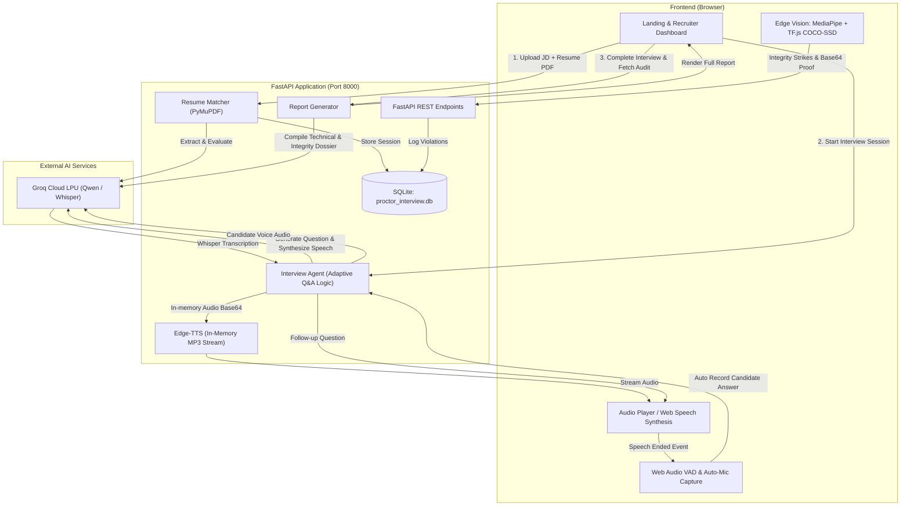

# AI Interview Pro — Autonomous Recruitment, Real-Time Voice Interview & Edge AI Proctoring

[](https://www.python.org/)
[](https://fastapi.tiangolo.com/)
[](https://groq.com/)
[](https://developers.google.com/mediapipe)
[](https://opensource.org/licenses/MIT)

> **AI Interview Pro** is an enterprise-grade, end-to-end recruitment platform that automatically screens resumes against job descriptions, conducts adaptive voice interviews via natural language processing and voice synthesis, monitors session integrity via client-side computer vision proctoring, and delivers structured evaluation dossiers for hiring teams.

---

## 🌟 Key Highlights

- ⚡ **Lightning-Fast Resume Screening**: Extract text with PyMuPDF and evaluate semantic JD-Resume alignment via Groq in under 3 seconds.
- 🎙️ **Hands-Free Conversational Voice Loop**: Zero manual clicking required. When the AI finishes asking a question, the candidate's microphone activates automatically; client-side Web Audio Voice Activity Detection (VAD) detects speech completion and auto-submits.
- 🛡️ **Zero-Cost Edge AI Proctoring**: Runs entirely in the candidate's browser without expensive server GPU streaming costs:
  - **MediaPipe Face Landmarker**: 3D blendshape eye gaze tracking (detects looking off-screen for >3s).
  - **TensorFlow.js COCO-SSD**: Real-time object detection for mobile phones and unauthorized devices.
  - **Tab & Window Visibility**: HTML5 `visibilitychange` tracking for unauthorized switching.
  - **Anti-Chain-Reaction Safeguard**: 5-second cooldown between strikes to eliminate false-positive cascade loops.
  - **Visual Proof Snapshots**: Automatically captures and records base64 webcam evidence with timestamps.
  - **Hardware Teardown**: Automatically stops camera, mic, and screen sharing tracks on interview termination.
- ⏱️ **Inactivity Safeguard**: 50-second countdown timer auto-advances the interview if a candidate is unresponsive.
- 📊 **Auditor Evaluation Dossier**: Generates scores (Overall, Technical, Problem Solving, Communication, Role Fit), detailed Q&A feedback, and a proctoring incident timeline.
- 🎨 **Modern Enterprise SaaS UI**: Dark obsidian & purple glow design with an interactive 3D laptop showcase, recruiter dashboard, cinematic interview stage, and comprehensive report viewer.

---

## 🏗️ System Architecture



---

## 💻 Tech Stack

### Backend
- **Framework**: [FastAPI](https://fastapi.tiangolo.com/) (Asynchronous, high performance)
- **ASGI Server**: [Uvicorn](https://www.uvicorn.org/)
- **LLM & Speech-to-Text**: [Groq Cloud SDK](https://console.groq.com) (`qwen/qwen3.8-27b` & `whisper-large-v3`)
- **Document Extraction**: [PyMuPDF (fitz)](https://pymupdf.readthedocs.io/)
- **Text-to-Speech**: [edge-tts](https://github.com/rany2/edge-tts) (In-memory asynchronous MP3 synthesis)
- **Database**: SQLite with parameterized transactions (`backend/database.py`)

### Frontend
- **Interface**: HTML5, Vanilla JavaScript (Modular ES6+), [Tailwind CSS](https://tailwindcss.com/)
- **Icons & Typography**: FontAwesome 6, Plus Jakarta Sans, Inter, JetBrains Mono
- **Edge Vision AI**:
  - [Google MediaPipe Vision](https://developers.google.com/mediapipe) (Face Landmarker & blendshapes)
  - [TensorFlow.js](https://www.tensorflow.org/js) with [COCO-SSD](https://github.com/tensorflow/tfjs-models/tree/master/coco-ssd) (Real-time object detection)
- **Audio Processing**: Web Audio API (`AudioContext`, `AnalyserNode`) for Voice Activity Detection and dynamic visualizers

---

## 📂 Project Structure

```text
AI-Assisted Coding Environments/
├── backend/
│   ├── __init__.py
│   ├── config.py             # Environment configurations & thresholds
│   ├── database.py           # SQLite schema, migrations & CRUD helpers
│   ├── interview_agent.py    # Adaptive 10-question interview engine & Whisper STT
│   ├── main.py               # FastAPI application & REST routing
│   ├── report_generator.py   # Auditor dossier compiler & scoring
│   ├── resume_matcher.py     # PDF parsing & semantic JD matching
│   └── tts_service.py        # Asynchronous edge-tts in-memory synthesis
├── frontend/
│   ├── css/
│   │   └── style.css         # Dark navy/violet design system & animations
│   ├── js/
│   │   ├── app.js            # View routing, dashboard stats & screening
│   │   ├── interview.js      # Hands-free loop, VAD, 50s countdown & audio
│   │   └── proctoring.js     # MediaPipe, TF.js, 3-strike policy & teardown
│   └── index.html            # Landing page, dashboard, interview room & report
├── .env.example              # Environment variables template
├── .gitignore                # Git ignore rules (keys, databases, caches)
├── requirements.txt          # Python dependencies
└── README.md                 # Project documentation
```

---

## 🚀 Getting Started

### 1. Prerequisites
- **Python**: Version `3.10` or higher
- **Groq API Key**: Obtain a free API key from [Groq Console](https://console.groq.com/keys)
- **Webcam & Microphone**: For live video proctoring and voice recording

### 2. Clone Repository
```bash
git clone https://github.com/Shashankshekhar05/Ai_Assisted_interview.git
cd Ai_Assisted_interview
```

### 3. Create & Activate Virtual Environment
```bash
# Windows (PowerShell)
python -m venv venv
.\venv\Scripts\Activate.ps1

# Linux / macOS
python3 -m venv venv
source venv/bin/activate
```

### 4. Install Dependencies
```bash
pip install -r requirements.txt
```

### 5. Configure Environment Variables
Copy `.env.example` to `.env` and configure your API key:
```bash
# Windows
copy .env.example .env

# Linux / macOS
cp .env.example .env
```

Edit `.env`:
```ini
GROQ_API_KEY=gsk_your_actual_groq_api_key_here
MATCH_THRESHOLD=70
MAX_STRIKES=3
ANSWER_TIMEOUT_SECONDS=50
PORT=8000
HOST=127.0.0.1
```

### 6. Run the Application
```bash
python -m uvicorn backend.main:app --host 127.0.0.1 --port 8000 --reload
```

Open your browser and navigate to:
```text
http://127.0.0.1:8000
```

---

## 📖 Step-by-Step Workflow

1. **Screening & Matching**:
   - Recruiters enter the target role and job description.
   - Upload candidate resume (`.pdf`).
   - Click **Analyze Alignment & Compute Score** to view the semantic match percentage, extracted experience level, key strengths, and missing skills.
2. **Device Permissions**:
   - Candidate clicks **Proceed to Live AI Voice Interview**.
   - System prompts for Camera, Microphone, and Screen Share access.
3. **Conversational AI Interview**:
   - The AI asks questions aloud with realistic neural speech.
   - Once the AI finishes speaking, the candidate's microphone activates automatically.
   - Candidate speaks naturally; when they stop speaking for 2.5 seconds, the answer is auto-submitted.
   - If silent for 50 seconds, the system auto-advances to prevent deadlocks.
4. **Edge AI Proctoring**:
   - MediaPipe monitors face orientation and gaze.
   - COCO-SSD detects mobile phones.
   - Violations trigger an on-screen warning and capture a timestamped proof snapshot.
   - After 3 strikes, the session auto-terminates.
5. **Auditor Dossier**:
   - Evaluates technical depth, problem-solving, communication, and role fit.
   - Provides question-by-question feedback with ratings out of 10.
   - Displays proctoring incidents with captured photographic evidence.
   - Recruiter marks decision: **Approve for Final Round**, **Request Follow-Up**, or **Reject**.

---

## 🛡️ Anti-Cheating & Integrity Engine

| Violation Type | Detection Mechanism | Safeguard |
|---|---|---|
| **Off-Screen Gaze** | MediaPipe Face Landmarker Blendshapes | Must look away continuously for >3s to trigger a strike. |
| **Mobile Phone** | TF.js COCO-SSD Object Classifier | Requires >65% confidence on `cell phone` class. |
| **Tab / Window Switching** | HTML5 `visibilitychange` API | Logs strike when browser window loses focus. |
| **Screen Share Stop** | MediaStream `track.onended` listener | Instantly flags when candidate cancels screen share. |
| **False-Positive Cascades**| Anti-Chain Timer | Enforces a strict 5-second cooldown between strikes. |

---

## 🔌 API Reference

| Method | Endpoint | Description |
|---|---|---|
| `POST` | `/api/match-resume` | Uploads PDF resume + JD text, returns match score & extracted profile. |
| `POST` | `/api/interview/start` | Initializes candidate session, generates Q1 & in-memory TTS audio. |
| `POST` | `/api/interview/answer` | Ingests voice webm / text, runs Whisper transcription, and generates follow-up question. |
| `POST` | `/api/proctoring/violation` | Logs integrity violation with base64 snapshot evidence. |
| `GET` | `/api/interview/{session_id}/report` | Compiles evaluation report, Q&A critique, and audit dossier. |
| `POST` | `/api/interview/{session_id}/decision` | Records recruiter hiring decision (`APPROVED`, `AUDIT_REQUIRED`, `REJECTED`). |

---

## 📄 License

This project is licensed under the [MIT License](LICENSE).
